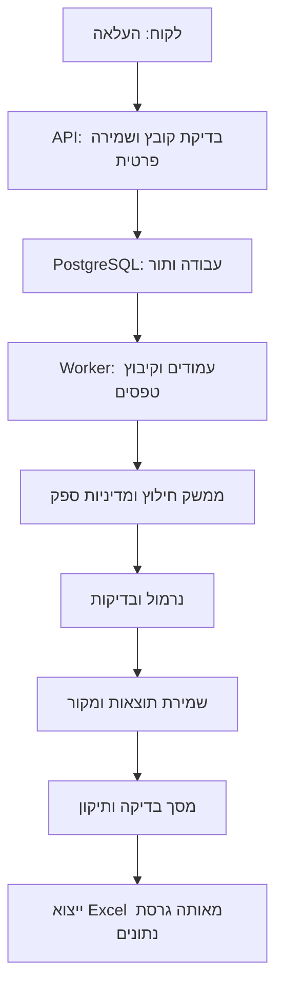

# הנחיות הפרויקט — מטפסי התחייבות לאקסל

מסמך החלטות ודרישות, גרסה 2, 13/10/2026. `CLAUDE.md` הוא תקציר העבודה היומי; מgeminiסמך זה מסביר את ההחלטות ומגדיר את גבולות המערכת. `SPECIFICATION.md` הוא האפיון הידידותי לנועה. אין עדיין מימוש או מדדי ביצועים מוכחים. החלטות שמסומנות כניסוי אינן הבטחה לאיכות.

## 1. רקע, מטרה ולוח זמנים

פרויקט להאקתון AI קוד פתוח, באתגר המעבדה המרכזית לנגיפים של משרד הבריאות. המעבדה מקבלת טפסי התחייבות מגורמים שונים, סרוקים, מצולמים ומודפסים, כולל כתב יד, מדבקות וחותמות. המערכת נועדה להפחית הקלדה ידנית: להפיק נתונים, להבליט ספק ולאפשר בדיקה וייצוא מהירים.

- דדליין אישי להגשה: **21/10/2026**, לפי בקשת נועה. שעה מדויקת טרם נמסרה.
- במסמך האתגר מופיע ערב גמר ב־28/10/2026; הוא אינו מאריך את דדליין העבודה שלנו.
- עבודה בשעות היום בלבד; אין עבודה בשבת 17/10. תכנון מ־14/10 נותן שבעה ימי עבודה עד 21/10 כולל יום ההגשה; אין להתייחס לכולם כימי פיתוח מלאים.
- יעד: ליבה עובדת עד 18/10, שילוב ועיצוב ב־19/10, אימות ותיעוד ב־20/10, מרווח הגשה ב־21/10. היקף שעות יומי והרכב הצוות טרם הוגדרו; זה יעד תכנון, לא התחייבות להספק.
- הבנייה מונחית AI, בספרינטים קטנים ומדידים; מספר הספרינטים אינו קבוע ל־28.

## 2. הצלחה עסקית וטכנולוגית

המשתמשת המרכזית היא מזכירה/עובדת מעבדה. השופטים כוללים קהל שאינו טכנולוגי; ההדגמה צריכה להראות צורך, תוצאה ותהליך בדיקה ברור בתוך דקות.

הערך הטכנולוגי: חילוץ מתמונות עם סכימה קשיחה, בדיקות דומיין, עיבוד עמיד ברקע, עקיבות לשדות, ניהול אי־ודאות, מנוע ניתן להחלפה ותכנון פרטיות. אין בידינו טבלת ניקוד מלאה או משקלים. לא מוסיפים OCR רק כדי להגדיל את רשימת הכלים; ניסוי מתועד שמצדיק הוספה או הימנעות הוא החלטה הנדסית שניתן להציג.

## 3. דרישות החילוץ

שדות: שם פרטי, שם משפחה, תעודת זהות, מספרים מרכזיים, תאריך קבלת הדגימה, גורם שולח, מספרי התחייבות.

- מספר מרכזי: ליד הכיתוב ״מרכזי״, לרוב במדבקה ולעיתים בכתב יד. לשמור את כל המספרים הקשורים לטופס.
- תאריך קבלה: חותמת ״התקבל״ או כתב יד מתחת למספר המרכזי. לא לבחור תאריך הפקה, לידה, טיפול או תוקף. כשיש מקורות סותרים — בדיקה אנושית.
- מספר התחייבות: גם ״דרישה״, ובלאומית גם ״דגימה״. לשמור ערכים מרובים בלי לערבב עם מספרים אחרים.
- גורם שולח: רשימה סגורה ומנוהלת של קופות ובתי חולים, עם כינויים ומקור ציבורי מתועד. להבחין בין הגורם השולח לנותן השירות; ערך לא מזוהה אינו מנוחש.
- שדה חסר/לא קריא נשאר ריק ומסומן. תעודת זהות ומספרי התחייבות נשמרים כמחרוזות, כולל אפסים מובילים.
- פרטי דוגמאות המארגנים שונו. כשל ספרת ביקורת בתעודת זהות מסמן בדיקה, ואינו הוכחה לכשל קריאה; יש להשוות גם לטקסט הגלוי במקור.
- סריקה עקומה, כהה, כתב יד, מדבקות חתוכות, ערכים מרובים וטפסים לא אחידים הם חלק מהקלט הצפוי.
- אין הנחה שעמוד אחד הוא טופס אחד: ייתכנו טופס רב־עמודי וכמה טפסים בעמוד. פיצול/קיבוץ לא ודאי יוצג לתיקון לפני אישור הרשומות; מקרה לא נתמך יסומן במפורש, לא יושמט.

## 4. סטאק והחלטות

| תחום | החלטה |
|---|---|
| שפות | TypeScript בצד לקוח, Python בצד שרת; SQL דרך שכבת נתונים |
| לקוח | React + Vite + MUI + TanStack Query, עברית RTL |
| שרת | FastAPI + Pydantic, ניהול באמצעות uv |
| נתונים | PostgreSQL + SQLAlchemy + Alembic |
| קבצים | אחסון פרטי דרך Storage; בדמו volume מקומי, בהמשך אחסון ארגוני |
| עמודים/תמונות | pypdfium2 + Pillow; שיפור נוסף רק בעקבות צורך מוכח |
| Excel | openpyxl |
| עיבוד | worker נפרד מאותו קוד Python ותור עבודות ב־PostgreSQL |
| אריזה | Docker Compose: client, API, worker, PostgreSQL |
| ניסויים | מחברת Jupyter ב־VS Code, קוראת לאותו קוד חילוץ של השרת |
| איכות | pytest לצד שרת, בדיקות רכיבים ממוקדות ו־Playwright לתהליך הראשי |

להשתמש בגרסאות יציבות ותואמות; לנעול תלויות ב־uv.lock ובקובץ נעילה של npm. לבחור גרסת Python/Node לאחר בדיקת תאימות למחשב Windows ולספריות, ולא לפי המספר הגבוה ביותר.

המנוע הראשוני הוא מודל ראייה שמקבל תמונת מקור, הוראות חילוץ וסכימה. מועמד ראשון שנדון: Gemini 3.8 Flash, בכפוף לזמינות בפועל בחשבון, עלות ותוצאות. GPT-6 Astra הוא מועמד להשוואה אם יש תקציב. אין דירוג דיוק מוכח ביניהם בטפסים האלה. לשמור provider/model דרך הגדרות ולתעד כל ריצה.

OCR נפרד הוא **הרחבה עתידית** בלבד. בדיקה קצרה שלו תתווסף אם איכות החילוץ מצדיקה זאת. אם משולב, נשמור טקסט ומיקומים ונעביר גם את התמונה; תמלול בלבד עלול לאבד הקשר. החלפת ספק אינה אוטומטית וטעונה החלטה מפורשת, גם בדמו.

מחברת נועדה לניסוי, לא לשרת. אין לשכפל בה את מנוע החילוץ או לייצר סביבת תלויות נפרדת. יש יכולת להריץ את מדידת הדיוק גם מסקריפט רגיל, מתחילתו ועד סופו.

### עברית וסביבת עבודה

עברית היא תנאי מרכזי לבחירת המודל, לא שיקול משני. יש לבדוק קריאה של עברית מודפסת, שמות בכתב יד, חותמות, RTL ושיוך מדויק של מספרים לשדות. אין צורך לתרגם שמות או לנרמל איות באמצעות ניחוש. שומרים raw מקורי; תיקון איות דורש ראיה/אישור אנושי. יכולת שיחה טובה בעברית אינה הוכחה לקריאה חזותית טובה. Gemini הוא מועמד בלבד עד ניסוי השוואתי על הדוגמאות; אין להציג אותו כמודל הטוב ביותר לעברית בלי תוצאות.

בדיקת בחירה ראשונית קצרה: אותם 10–15 טפסים, אותן תשובות ידניות, אותן דרישות פלט; למדוד עברית מודפסת וכתב יד בנפרד. לשמור כמה טפסים לבדיקה שלא שימשה לשיפור הפרומפט. לא לבחור כלי OCR עתידי רק כי כתוב שהוא ״תומך בעברית״; לברר בנפרד תמיכה בכתב יד בעברית.

פיתוח מומלץ: VS Code מקומי + Git, uv ו־npm, ומחברת מקומית לניסוי. בענן אפשר להשתמש אם ההתקנה המקומית חוסמת; יש לבדוק תמיכה ב־worker, אחסון מתמשך, PostgreSQL, סודות ותקציב לפני מעבר. sandbox הוא סביבת עבודה מבודדת, לא בהכרח ענן ולא הבטחת פרטיות. גם ממחשב מקומי, פנייה ל־API חיצוני שולחת את הקלט החוצה. נפרוס גרסה דקה מוקדם לאחר שהמסלול המקומי עובד.

## 5. מבנה מערכת ותהליך

מודולרי בתוך קוד שרת אחד: API, services, domain, providers, storage, repositories, worker. המודל אינו מקבל גישה למסד הנתונים, לדפדפן, לכלים או להרצת קוד.

גבולות חשובים:

- `ExtractionProvider.extract(form, schema) -> ExtractionResult`: מתאמים מחזירים חוזה דומיין אחיד. SDK של ספק מופיע רק במתאם.
- `OcrProvider` יוגדר רק כממשק הרחבה כשיידרש; אין צורך לממש רכיב ריק מסובך.
- `Storage`: שמירה, קריאה מורשית, מחיקה; ללא נתיבים ציבוריים.
- `Validator`: חוקי שדות, נרמול וסיבות לבדיקה; אינו קורא למודל.
- `Exporter`: מייצא snapshot של נתונים נבדקים; אינו מחלץ מחדש.

### הסבר פשוט: מה פירוש גבולות אלה?

אלה הוראות לארגון הקוד, לא מוצרים חדשים ולא חמישה שרתים. כל רכיב הוא חלק מהשרת שלנו עם אחריות מוגדרת. אפשר להתחיל מפונקציות/מודולים קטנים; אין חובה לבנות היררכיית מחלקות מורכבת.

| רכיב | משמעות פשוטה | דוגמה |
|---|---|---|
| ExtractionProvider | כתובת אחידה בקוד לכל בקשת חילוץ | ״קבלי טופס והחזירי שדות״, בלי ששאר הקוד יודע אם מחובר Gemini או מודל פנימי |
| Adapter / מתאם | מתרגם בין השירות המסוים למבנה שלנו | מתאם Gemini מכין בקשה לפי ה־SDK שלו וממיר תשובה ל־ExtractionResult |
| OcrProvider | חיבור עתידי ל־OCR, אם ניסוי יצדיק אותו | כרגע אינו מופעל ואינו נדרש למימוש |
| Storage | החלק שאחראי לקבצים | שומר PDF פרטי, מחזירו רק אחרי בדיקת הרשאה ומוחק אותו ואת הנגזרות |
| Validator | בדיקות קבועות שאנחנו כותבות | תאריך תקין, מספרים כמחרוזות, שדה חסר או מקורות סותרים → דגל לבדיקה |
| Exporter | החלק שיוצר Excel מהתוצאות שנשמרו | משתמש בערך שהמזכירה תיקנה, ולא שולח שוב למודל |

`extract(form, schema) -> ExtractionResult` פירושו: פעולה בשם extract מקבלת טופס והגדרת השדות הצפויים, ומחזירה תוצאה במבנה שהגדרנו. ״חוזה דומיין״ הוא פשוט ההסכמה של כל חלקי המערכת על מבנה זה. SDK הוא ספריית החיבור הרשמית של ספק. משאירים אותה במתאם כדי שלא תהיה תלות בו בכל השרת.

`snapshot` פירושו העתק עקבי של הנתונים ברגע הייצוא. אם המזכירה תיקנה מספר ל־123, האקסל חייב להכיל 123 מאותה גרסה; אין חילוץ מחדש שעלול להחזיר מספר אחר. ההפרדה חשובה במיוחד ליכולת החלפת מודל, בדיקה של כל רכיב ותיקון באגים בלי לפגוע ברכיבים אחרים.

## 6. נתונים, עקיבות ומצבים

ישויות בסיס: session, batch, source_file, page, form_record, field_result, job, review_event. שדות מקור/תיקון לא יידרסו זה על ידי זה.

לכל שדה: `raw_value`, `normalized_value`, `source_refs`, `review_reasons`, `review_state`, וערך מתוקן אם קיים. מספרים מרובים הם מערכים. מקור כולל מזהה קובץ ועמוד, וטקסט תומך; אזור תמונה הוא אופציונלי. קואורדינטות שחזרו מהמודל אינן עובדה: לבדוק שהן בטווח ולהציגן למשתמשת; אם אינן מהימנות להציג את כל העמוד, בלי להמציא תקריב.

מצבי שדה: `extracted`, `needs_review`, `approved`, `accepted_empty`. סיבות לדוגמה: `missing`, `unreadable`, `invalid_format`, `ambiguous_source`, `conflicting_values`, `uncertain_grouping`.

- תוצאה מוצעת ללא בעיה מזוהה: סגנון ניטרלי, לא הבטחה לנכונות.
- כתום: נדרשת בדיקה, כולל ערך חסר. הסיבה מוצגת בטקסט ואייקון, לא רק בצבע.
- ירוק: אישור אנושי בלבד.
- פלט המודל יכול להביע ספק, אך אין להציג אחוז ביטחון לא מכויל.
- תקינות סכימה/תאריך/ספרת ביקורת אינה מוכיחה שיוך נכון או נכונות מלאה.
- כדי לסיים בדיקה נדרש טיפול בכל דגל: תיקון, אישור הערך או קבלה מפורשת כריק. אפשר לאשר יחד ערכים לא מסומנים; אין לטעון שכולם נבדקו פרטנית.

מצבי עבודה: `queued`, `processing`, `completed`, `partial`, `failed`, `cancelled`. כשל טופס אחד אינו מוחק את האחרים. שמירת משימה לפני פנייה לספק, claim אטומי עם lease/heartbeat, התאוששות לאחר עצירה, retries מוגבלים והמתנה על 429. אין לנסות שוב שגיאות קבועות ללא שינוי.

לכל רשומה revision. עדכונים עם גרסה צפויה; התנגשויות מחזירות 409. ריצה חוזרת לא דורסת תיקונים מאושרים. תוצאות worker מתעדכנות באופן idempotent; אירועי review אינם משכפלים מזהים רגישים בלוגים. כפילות hash מסומנת בתוך session לבדיקה, בלי למחוק מסמכים אוטומטית ובלי לחשוף כפילויות של משתמשים אחרים.

## 7. API מוצע

| פעולה | נתיב |
|---|---|
| יצירת session דמו | `POST /api/sessions` |
| העלאת קבצים ויצירת batch | `POST /api/batches` |
| סטטוס והתקדמות | `GET /api/batches/{id}` |
| רשומות ושדות | `GET /api/batches/{id}/records` |
| גישה מורשית לעמוד מקור | `GET /api/pages/{id}/image` |
| תיקון/אישור עם revision | `PATCH /api/records/{id}` |
| תיקון קיבוץ טפסים | `PATCH /api/batches/{id}/grouping` |
| ניסיון חוזר מוגבל | `POST /api/jobs/{id}/retry` |
| ייצוא snapshot מאושר | `POST /api/batches/{id}/exports` |
| מחיקת batch ונתוניו | `DELETE /api/batches/{id}` |

API תחת אותו origin של הלקוח בפריסה, עם cookie של session סודי, HttpOnly, Secure בפריסת HTTPS ו־SameSite. הרשאה לכל משאב לפי session; CORS אינו מנגנון הרשאה. לבדוק Origin/CSRF לפעולות שינוי. אין צורך ברולים בדמו, אבל API ציבורי אינו יכול לאפשר לכל אדם לקרוא נתונים לפי ID. הגבלת קצב וגודל גם ליצירת session כדי לצמצם ניצול מכסת המודל.

## 8. אבטחה ופרטיות

שני מצבים מוגדרים:

1. `demo_external`: רק דוגמאות ששונו; אזהרה במסך. אין יכולת טכנית להבטיח שהמשתמשת לא העלתה מידע אמיתי, ולכן מומלץ דמו מוגבל גישה/קבצי דוגמה מובנים בהצגה ציבורית.
2. `internal`: רק endpoints מאושרים לשירותים פנימיים. ספק חיצוני או כתובת לא מאושרת גורמים לעצירה. אין fallback חיצוני. מתאם מדומה מוכיח החלפה טכנית בלבד; חיבור אמיתי מחייב שירות ראייה פנימי מתאים ובדיקת דיוק מחדש.

מעבר למשרד מחייב גם בקרת egress ברשת, TLS, זהויות ארגוניות, ניהול סודות, הצפנה במנוחה, מדיניות גיבוי ושימור, סקירת אבטחה ואישור הגוף. Docker או שינוי משתנה סביבה אינם אישור למידע רפואי.

דרישות לדמו:

- מפתחות בסביבת השרת בלבד, `.env.example` ללא סודות; אין מפתחות או טפסים ב־Git.
- ללא לוגים של prompt/response, טקסט OCR, שמות, מספרים, תמונות או שמות קובץ רגישים. לוגים כוללים IDs אקראיים, סטטוס, משך וקוד שגיאה מסונן. ללא telemetry של תוכן.
- אחסון פרטי של originals, crops, results, exports; הגשה דרך API מורשה, `Cache-Control: no-store` לתוכן רגיש.
- שימור דמו מוצע: 24 שעות מסיום, ניתן להגדרה; מחיקה מיידית לבקשת המשתמשת. cleanup גם לעבודות נכשלות ולתוצרי ביניים. לא להבטיח מחיקה מגיבויים או מספק חיצוני בלי מדיניות שתומכת בכך.
- העלאות: PDF/JPEG/PNG בלבד, בדיקת תוכן ממשי ולא רק extension/MIME. ספי bytes/pages/pixels/time מוגדרים. הגנה מפני decompression bombs, נתיבים זדוניים וקבצים פגומים/מוצפנים; conversion ב־worker מוגבל משאבים.
- מסמכים הם מידע לא מהימן, לא הוראות. אין לציית לטקסט ״התעלמי מההנחיות״ בטופס; schemas ובדיקות דומיין. אין fetch של URLs שמופיעים במסמך.
- מחברות מקומיות, תוצאות מנוקות לפני commit. mock ותיעוד משתמשים בנתונים סינתטיים.

## 9. Excel

שורה לכל רשומת טופס התחייבות לוגית. אם בטופס כמה מספרי התחייבות/מספרים מרכזיים — נשמור את כולם באותו תא, מופרדים באופן עקבי; זו פרשנות זמנית עד שהמעבדה תאשר פורמט. אין לבצע מכפלה של הרשימות ואין להניח התאמה בין המספרים לפי סדר.

עמודות הדמו: שם פרטי, שם משפחה, תעודת זהות, מספר מרכזי, תאריך קבלת הדגימה, גורם שולח, מספר התחייבות. סדר/כותרות/פורמט של המעבדה טרם סופקו; exporter יקבל הגדרה נפרדת להחלפתם.

מספרי מזהים כתאים מסוג טקסט. תאריכים בפורמט מוסכם, ללא תיקון כפוי של תאריך לא ברור. ערכים שמתחילים בתווי נוסחה כגון `=`, `+`, `-`, `@` ייכתבו כטקסט ולא כנוסחה. הייצוא משתמש באותה revision שנבדקה; שינוי במקביל אינו נכלל בשקט. אין טופס שנעלם מהייצוא בלי הסבר. כשלונות/השמטות מכוונות מסוכמים במסך.

## 10. UX ועיצוב להגשה

הכיוון: כלי עבודה בהשראה רפואית־ממשלתית, לא העתק של פורטל מידע. עברית RTL, רקע בהיר, כחול כהה, טורקיז וכתום לבדיקות. הצבעים הם בחירת עיצוב שלנו, לא טענה שזה מותג רשמי. שם עבודה: ״טופס למידע״; ניתן לשינוי.

מסך מרכזי מציג טבלה ומסמך זה לצד זה; לחיצה על שדה פותחת את המקור ותקריב אם קיים. קל לראות: מספר טפסים, התקדמות, כמה שדות דורשים בדיקה ומה נשאר עד ייצוא. סינון ״דורש בדיקה״, עריכה במקלדת, zoom/rotation, ניווט בין טפסים, הודעות שגיאה ברורות ומצבי טעינה/ריק מושקעים.

העיצוב צריך להרשים באמצעות שימושיות וגימור: ריווח, טיפוגרפיה אחידה, היררכיה, תגובה מהירה ואנימציה קצרה בלבד. ניגודיות ופוקוס נראים לעין; צבע אינו הדרך היחידה להבין מצב. לא להציג מדדי חיסכון/דיוק מומצאים. אין צורך בעמוד בית ארוך או גרפים שאינם משרתים בדיקה.

תווית ברורה: ״דמו להאקתון — מיועד לטפסי הדוגמה״. אין סמל מדינה/לוגו משרד או רושם שהמערכת רשמית ללא הרשאה. בהטמעה מאושרת ניתן להחליף theme/branding בלי לשנות לוגיקה. עיצוב מוסדי אמין מתאים; התחזות להמשך האתר אינה המטרה.

## 11. סדר ספרינטים וגבולות היקף

אלה שלבי בנייה; כל שלב יפורק לפרומפטים קטנים בעת הביצוע. כל פרומפט כולל תלויות, קבצים, שינוי מוגדר ובדיקת קבלה.

| סדר | תוצר | תנאי סיום |
|---|---|---|
| 1 | מיפוי טפסים וטבלת אמת של 10–15 טפסים | תשובות מדויקות, מקרי קצה ותיעוד עמודים; חלק נשמר לבדיקה שלא מכוונים עליה |
| 2 | ניסוי ראייה עם סכימה ומדידה | בחירת מועמד לפי נתונים וזמינות; תיעוד טעויות ובדיקה של קלט פגום |
| 3 | שלד React/API/DB/worker ו־Compose | הרצה מקומית מתועדת, migration ותהליך mock מקצה לקצה |
| 4 | העלאה ועבודה עמידה | worker מקבל עבודה, עדכונים במסך, כשל חלקי ו־retry בלי כפילויות |
| 5 | עמודים, קיבוץ וחילוץ אמיתי | מקור שמור לכל רשומה, ריבוי ערכים, גבולות טפסים ניתנים לבדיקה |
| 6 | validators ומסך review | דגלים וסיבות, תיקון/אישור, שמירה עם version ומקור זמין |
| 7 | Excel מקצה לקצה | כל השדות, אפסים מובילים, ערכים מרובים וחסימת נוסחאות |
| 8 | פרטיות, פריסה וגימור | session isolation, ניקוי, internal fail-closed, דמו RTL עובד בפריסה שנבחרה |
| 9 | הערכה, תיעוד ודמו שופטים | תוצאות כנות, מגבלות, README והדגמה מוכנה לפני יום ההגשה |

אבטחה ועיצוב בסיסיים נכנסים כבר בשלד; שלב 8 הוא השלמה ואימות. יש לפרוס מוקדם גרסה דקה, לא לחכות לשלב 8 כדי לגלות בעיות hosting. אחסון Postgres וקבצים חייב להיות מתמשך; לא להניח filesystem זמני של פלטפורמת אירוח מתאים. שרת/worker מקומיים עם Compose הם נתיב גיבוי להדגמה אם אירוח נחסם.

בתחום ההגשה: קלט מרובה, review, כל שבעת השדות, ריבוי מספרים, ייצוא, תיעוד מדידה ופרטיות. מחוץ לתחום הראשוני: חיבור חי למערכות משרד, SMS/WhatsApp, אפליקציית מובייל, RAG, מסד וקטורי, multi-agent, אימון מודל, מערכת רולים מורכבת. OCR או קריאה נוספת על תקריב יתווספו רק לפי הכשל שנמדד.

## 12. בדיקות קבלה ומדידה

- זרימה עובדת: upload→job→review→export, גם עם תקלה באחד הטפסים.
- שמירת כל המספרים המרובים בלי שינוי ספרות ואפסים; תאריך קבלה נבדל מתאריך הפקה.
- טופס חתוך/לא קריא נשאר ריק כשאין ראיה, מסומן ומוצג לתיקון.
- טעויות grouping אינן משתיקות או ממזגות מטופלים בלי סימון.
- עריכה נשמרת לאחר refresh; retries לא מוחקים תיקונים; edit/export מתמודדים עם version conflict.
- API מונע גישה למקור/תוצאה של session אחר.
- internal mode דוחה ספק/endpoint חיצוני; כשל פנימי אינו פונה לענן.
- מחיקה מסירה מקור ותוצרים; לוגי שגיאה אינם מכילים תוכן; מפתח אינו מופיע ב־bundle.
- Excel נבדק בפתיחה מחדש: סוגי תאים, כותרות, תאריכים, מספרים מרובים ונטרול נוסחאות.
- מדדים: דיוק לכל שדה, מספר טעויות שלא סומנו, שיעור טעויות שסומנו, דגלי שווא, שיעור בדיקה אנושית, זמן ועלות לטופס.
- להפריד איכות חילוץ לפני תיקון מאיכות אחרי בדיקה אנושית; להציג גודל מדגם וסוגי הטפסים. מדגם קטן אינו הבטחת דיוק בעולם האמיתי.
- למדידת התנהגות בעת קלט גרוע ניתן ליצור עותקי דוגמה מטושטשים/חתוכים, תוך שמירת המקור והתיוג. לא להציג אותם כנתוני לקוחות אמיתיים.

## 13. נושאים שיש לסגור בתחילת העבודה

סדר עדיפויות: שעות יומיות/צוות; מפתח API נגיש דרך הסינון ותקציב; שירותי Docker במחשב; פורמט האקסל המדויק; שעת ההגשה וקריטריוני ניקוד; סוג פריסה. אין לעכב ניסוי חילוץ או שלד בגלל נושא שאינו חוסם אותם. יש לתעד הנחות ולבנות נקודות שינוי, לא להמציא תשובות.

## מקורות והבחנה בין דרישה להחלטה

מקור מחייב לתכולה: ״הנחיות האתגר — המעבדה המרכזית לנגיפים״ שסופק; דוגמאות חלקים 1 ו־2. מסמך ״ארגז הכלים החינמי״ הוא המלצה של המארגנים, לא התחייבות למחירים/מכסות/זמינות. סטאק, retention, session design ופורמט ריבוי ערכים כאן הם החלטות תכנון שלנו.

תיעוד לבדיקת החלטות:
- https://fastapi.tiangolo.com/features/
- https://docs.astral.sh/uv/guides/projects/
- https://docs.astral.sh/uv/guides/integration/jupyter/
- https://ai.google.dev/gemini-api/docs/models
- https://ai.google.dev/gemini-api/docs/document-processing
- https://ai.google.dev/gemini-api/docs/structured-output
- https://developers.openai.com/api/docs/models/gpt-6-astra
- רשימת מוסדות לצורך בניית lookup: https://registries.health.gov.il/Institutions/Institutions/1 — יש לסנן קופות/בתי חולים רלוונטיים, לא להעתיק את כל סוגי המוסדות.

אין מסמך שיכול להבטיח ארכיטקטורה ללא טעויות. נקודות ההגנה הן חוזים ברורים, ניסוי מוקדם, בדיקות קבלה, עבודה מקצה לקצה ומרווח לתיקון לפני הדדליין.
